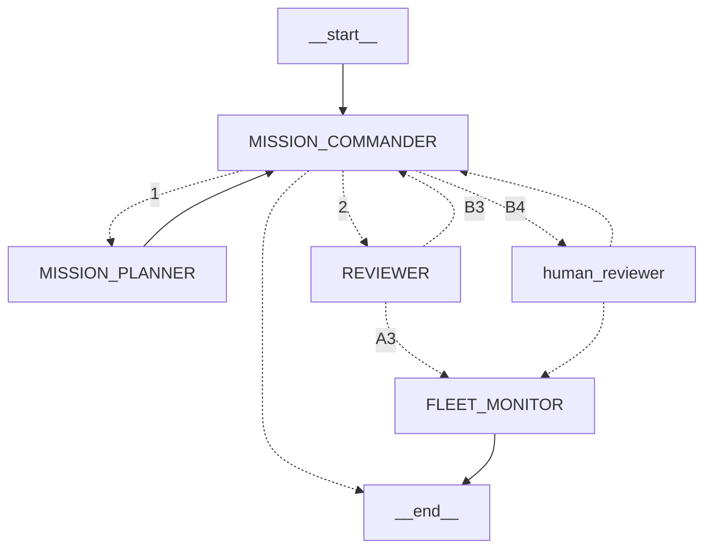

# drone-ops
Agentic Multi-UAV Mission Control &amp; Incident Recovery

This repo is split between a simulator and an agent team. 

The simulator runs a discrete time UAV drone search and rescue simulation
on a discrete grid partitioned into sectors.
Each sector has its own terrain profile, weather, target population and
target survival profile reflecting its hazard level.
The global weather and challenge difficulty is determined by a scenario card.

The agent team is a harness for multi-agent cooperation.
The roles are fleet monitor, mission commander, mission planner, and reviewer.
Each role is provided with a set of informed tools whose dependencies are injected
with a simulator dispatcher.
The agents run on a LangGraph graph where the mission commander acts as a high level
posture setter and a router.
All inputs and outputs for agents are TypedDicts as guardrails.
A disagreement between the mission commander and reviewer results in human review.

Each agent acts using a policy.
This repo provides OpenAI LLM policies as well as naive heuristic policies.

A world builder utility which can generate a random world from a scenario card
can be found in `scenario.py`.