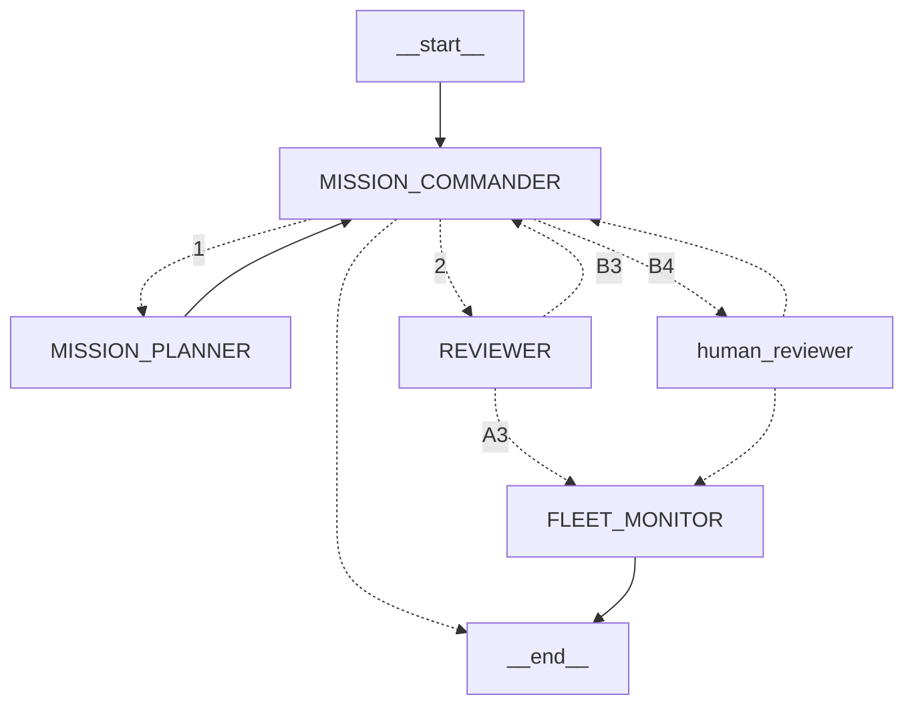

# drone-ops
Agentic Multi-UAV Mission Control &amp; Incident Recovery

The simulator takes a generated `World` and its `Scenario`:

```python
from src.models import Objective, ObjectiveType
from src.scenario import Difficulty, Scenario, Weather, generate_world
from src.simulator import Simulator

scenario = Scenario(
    world_size=(25, 25), num_sectors=4, num_targets=12,
    difficulty=Difficulty.MEDIUM, num_drones=3, base_position=(0, 0),
    events={}, weather=Weather.CLOUDY, recharge_rate=5.0,
)
simulator = Simulator(generate_world(scenario), scenario)
events = simulator.step({
    drone_id: Objective(drone_id=drone_id,
                        objective_type=ObjectiveType.SEARCH_SECTOR,
                        sector_id=str(index))
    for index, drone_id in enumerate(simulator.drones)
})
```

`step()` advances one turn and retains accepted orders when no plan is supplied.
An empty plan holds all connected drones. `execute_plan(plan, max_steps=80)` runs
until a selected or free watch triggers, or the turn limit, and returns
`(alerts, explored_cells, timestep)`.
The simulator exposes `discovered_targets` as target IDs mapped to positions;
use those IDs with `GOTO` orders. Reaching a target records a rescue in
`simulator.world`; remaining targets can expire each turn. Sensing uses sector
visibility and weather, and movement uses the destination sector's battery cost.
The scenario supplies incidents and weather transitions each turn.
Weather drifts toward an equal blend of the scenario level and the average
weather of sectors sharing an edge. Neighbour averages use the pre-update
weather snapshot; isolated sectors drift toward the scenario level alone.
Shared-edge neighbours are cached when the world is created, including partial
edge overlaps in T-junctions and staggered sector layouts.
All drones can share `world.base_position`.
Drones ending a turn at base gain `scenario.recharge_rate` battery units,
up to 100.0, including drones that have exhausted their battery.
Each powered drone outside base has a 1% chance per turn of a communications
failure in stormy weather, or 2% in blizzards, including while holding position.
Communications failures can be watched with `COMMS_LOST_FOR`.

The older mission orchestration below still uses the previous simulator API and
needs migration before it can run with this simulator.

The fleet monitor chooses a `MonitoringPlan` containing exactly three
`WatchPredicate` instances and a nonempty `reason`. Its policy receives a detached
copy of the accepted mission plan, the review, and the current turn.
`FleetMonitor.run()` stores the result in `MissionState.monitoring_plan`.
Agents will access additional information through a separate tool suite.

Policies are required when constructing agents. Shared policy contracts,
`CommanderRoutingDecision`, and `FleetMonitorObservation` live in `models.py`.
Fleet monitoring uses `Policy[MonitoringPlan]`, like the other result-specific
policies. Naive policy implementations remain in `policy.py` and are used only
when explicitly supplied. The heuristic watch selector remains deferred.
Graph construction requires every software role to be configured through
`agents` or `nodes`; no agent or policy is selected implicitly.



Each planning cycle starts at the commander. Reviewer revisions return to the
commander, who can request replanning, resubmit a proposal, or send it to
`human_reviewer` for arbitration. Reviewer and human approvals pass through the
fleet monitor before the cycle ends; human rejection returns to the commander.
Review outcomes are `ReviewResult` objects with an `outcome`, `critique`,
`concerns`, and `mandatory_watches`. Outcomes are `approve`, `replan`, or
`reconsider_priority`; the latter two return to the commander.

The reviewer checks both the commander's priorities and the candidate plan.
A decision to retain the accepted plan is also sent to the reviewer with its
reason; `needs_replan=False` cannot bypass review. The reviewer can request
replanning or reconsideration of priorities before monitoring resumes.

The simulator owns drone state, controllers, and private watch history.
Mission state contains known drone IDs and typed `WatchAlert` records in `events`
and `latest_events`. Build each mission graph with explicitly configured policies:

```python
from src.agent import MissionCommander, MissionPlanner, Reviewer, FleetMonitor
from src.models import AgentType

workflow = build_mission_graph(agents={
    AgentType.MISSION_COMMANDER: MissionCommander(policy=commander_policy),
    AgentType.MISSION_PLANNER: MissionPlanner(policy=planner_policy),
    AgentType.REVIEWER: Reviewer(policy=reviewer_policy),
    AgentType.FLEET_MONITOR: FleetMonitor(policy=monitoring_policy),
}).compile()

def control_cycle(state):
    return MissionState.model_validate(workflow.invoke(state))

result = control_cycle(mission_state)
assert result.current_plan is not None and result.monitoring_plan is not None
simulator.set_monitoring_plan(result.monitoring_plan)
alerts, explored_cells, step = simulator.execute_plan(result.current_plan.plan)
```

Each role can instead use a model-backed policy with its own tool registry:

```python
from src.agent import MissionCommander, MissionPlanner, Reviewer, FleetMonitor
from src.llm_policy import ToolCallingPolicy
from src.models import AgentContext
from src.tools import ToolGateway

workflow = build_mission_graph(agents={
    AgentType.MISSION_COMMANDER: MissionCommander(
        policy=ToolCallingPolicy(commander_model, AgentType.MISSION_COMMANDER)),
    AgentType.MISSION_PLANNER: MissionPlanner(
        policy=ToolCallingPolicy(planner_model, AgentType.MISSION_PLANNER)),
    AgentType.REVIEWER: Reviewer(
        policy=ToolCallingPolicy(reviewer_model, AgentType.REVIEWER)),
    AgentType.FLEET_MONITOR: FleetMonitor(
        policy=ToolCallingPolicy(monitor_model, AgentType.FLEET_MONITOR)),
}).compile()
result = workflow.invoke(
    mission_state,
    context=AgentContext(tools=ToolGateway(simulator_dispatcher)),
)
```

Every domain agent depends only on a policy interface. Heuristic, LLM, and RL
policies share `evaluate(observation, tools=...)`. `tools` is a role-scoped
mapping of `Tool` values to already-bound LangChain tools:

```python
report = tools[Tool.GET_FLEET_STATUS].invoke({})
```

The simulator delegates tool calls to an injected `ToolService` (defined in
`models.py`). `services.py` provides `SimulatorTools`, with an explicit
`NotImplementedError` stub for every tool operation:

```python
from src.services import SimulatorTools

simulator = Simulator(world, scenario, tool_service=SimulatorTools())
gateway = ToolGateway(simulator.call_tool)
```

`call_tool()` supplies a fresh, detached `observation_view()` containing current
mission knowledge. It does not advance the simulation or expose the hidden
target archive or true model parameters. Service implementations can extend
this view as their input requirements are implemented.

Tools are defined once with `@tool` in `src/tools.py`. `ToolGateway.for_role()`
binds their simulator dispatcher and returns only the role's permitted tools.
LangChain validates tool arguments; role selection limits the available tools.
Results are copied to avoid sharing mutable simulator data. Policies receive neither simulator context nor simulator
objects, and no runtime dependency appears in model-visible argument schemas.

Heuristic and RL policies invoke these tools directly without creating an LLM
agent. `ToolCallingPolicy` alone owns a model and its `create_agent` loop, using
the same supplied tools and validating the final decision. A policy can be
reused across simulator runs because bindings belong to the supplied tool set.

Commander and monitor get four observation tools. Planner also gets route
planning, route costing, and plan evaluation; reviewer gets forecasting, plan
evaluation, and stress testing. Explicit node overrides take precedence over
entries in `agents`. Use `agents` to mix policy backends while preserving the
graph's role-scoped tool wiring; raw node overrides manage their own dependencies.

Watch predicates are dispatched by `src.watch.check_watch(predicate, context)`.
`WatchContext` supplies the world, turn, internal battery/comms history, sector completion,
route costs, explored cells, and known/acquired target IDs. Checks are read-only.
For example:

```python
from src.models import MonitoringPlan, WatchPredicate, WatchType

simulator.set_monitoring_plan(MonitoringPlan(watches=[
    WatchPredicate(type=WatchType.CHARGE_ABOVE, drone_id="0", threshold=90),
    WatchPredicate(type=WatchType.COMMS_LOST_FOR, drone_id="1", horizon=3),
    WatchPredicate(type=WatchType.ROUTE_UNREACHABLE, drone_id="2"),
], reason="Watch charging, communication, and the accepted route."))
simulator.on_alert = lambda alerts: control_cycle_for_alerts(alerts)
```

The callback runs once for each batch of newly true watches. A condition must
clear before it can alert again, or the agent can arm a fresh set with
`set_monitoring_plan()`. Only the three chosen optional predicates are evaluated.
The three `FreeWatchType` hooks always run across their relevant entities:

- `NEW_TARGET_DETECTED`: each newly observed target, with the detecting drone.
- `DRONE_HARD_FAILURE`: each drone with no battery away from base.
- `MISSION_COMPLETE`: every reachable traversable cell has been observed and
  every known target has a confirmed acquisition. Obstacle cells, no-fly cells,
  and cells disconnected from the base and initial drone positions are excluded
  from coverage. Temporary drone occupancy and battery limits do not make cells
  unreachable. Reachability is refreshed when terrain restrictions change.

Completion uses persistent observed target IDs and reported acquisitions, not
the simulator's hidden target count or failure list. An expired known target
does not count as acquired. A completion alert reports `SUCCESS`.

Free watches run even without a monitoring plan and do not consume its three
slots. Installing a new monitoring plan does not repeat an existing free alert.
`step()` and `execute_plan()` return only `WatchAlert` records. Incidents, rescues,
expiry, sector completion, route failures, and plan exhaustion update simulation
state but do not independently invoke the agent loop. At the turn limit,
`execute_plan()` returns an empty alert list without calling the callback.
The callback is the integration point for the agent loop.

`CHARGE_ABOVE` only matches drones at base. `COMMS_LOST_FOR` measures consecutive
elapsed disconnected turns. `BATTERY_DRAIN_ABOVE` compares battery loss over
`horizon` turns (default one). `RETURN_RESERVE_BELOW` subtracts the estimated
battery cost of a shortest traversable return route. `ROUTE_COST_INCREASED_BY`
compares current remaining-route cost against the accepted route when armed.
`TARGET_NOT_REACHED_BY` treats `horizon` as an absolute turn deadline.

Weather forecast risk is the probability of reaching stormy or blizzard weather
within the horizon. It uses a cheap, deterministic scenario-only forecast that
intentionally ignores neighbouring weather. It does not change the world or
consume simulation randomness.

`TARGET_SURVIVAL_PROBABILITY_BELOW` requires `decay_rate_prior` as well as the
probability `threshold` and turn `horizon`. It forecasts survival for the specified
target ID using the supplied removal prior, independently of other target
counts and the sector's true decay rate. Per-turn survival is `1 - exp(-prior)`;
a zero prior disables removal, matching the simulator. For example:

```python
WatchPredicate(
    type=WatchType.TARGET_SURVIVAL_PROBABILITY_BELOW,
    target_id="target_0", threshold=0.5, horizon=10, decay_rate_prior=2.0,
)
```

## TODO
- mission priorities
- tools in simulator
- skills
- openai api policies