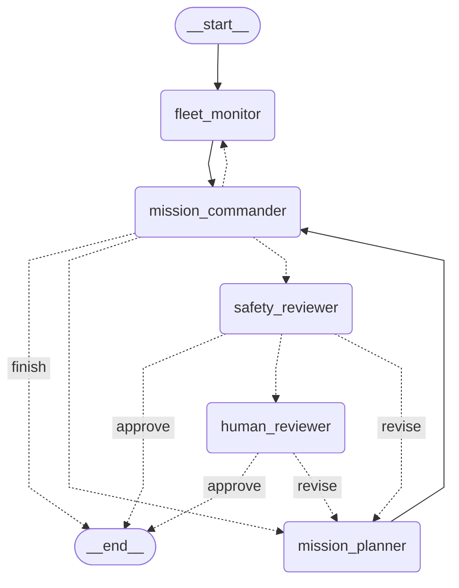

# drone-ops
Agentic Multi-UAV Mission Control &amp; Incident Recovery

The simulator takes a generated `World` and its `Scenario`:

```python
from src.models import Objective, ObjectiveType
from src.scenario import Difficulty, Scenario, Weather, generate_world
from src.simulator import Simulator

scenario = Scenario(
    world_size=(25, 25), num_sectors=4, num_targets=12,
    difficulty=Difficulty.MEDIUM, num_drones=3, base_position=(0, 0),
    events={}, weather=Weather.CLOUDY, recharge_rate=5.0,
)
simulator = Simulator(generate_world(scenario), scenario)
events = simulator.step({
    drone_id: Objective(drone_id=drone_id,
                        objective_type=ObjectiveType.SEARCH_SECTOR,
                        sector_id=str(index))
    for index, drone_id in enumerate(simulator.drones)
})
```

`step()` advances one turn and retains accepted orders when no plan is supplied.
An empty plan holds all connected drones. `execute_plan(plan, max_steps=80)` runs
until an event or the turn limit and returns `(events, explored_cells, timestep)`.
The simulator exposes `discovered_targets` as target IDs mapped to positions;
use those IDs with `GOTO` orders. Reaching a target records a rescue in
`simulator.world`; remaining targets can expire each turn. Sensing uses sector
visibility and weather, and movement uses the destination sector's battery cost.
The scenario supplies incidents and weather transitions each turn.
Weather drifts toward an equal blend of the scenario level and the average
weather of sectors sharing an edge. Neighbour averages use the pre-update
weather snapshot; isolated sectors drift toward the scenario level alone.
Shared-edge neighbours are cached when the world is created, including partial
edge overlaps in T-junctions and staggered sector layouts.
All drones can share `world.base_position`.
Drones ending a turn at base gain `scenario.recharge_rate` battery units,
up to 100.0, including drones that have exhausted their battery.
Each powered drone outside base has a 1% chance per turn of a communications
failure in stormy weather, or 2% in blizzards, including while holding position.
Failures are reported by periodic monitoring.

The older mission orchestration below still uses the previous simulator API and
needs migration before it can run with this simulator.

The fleet-monitor policy receives telemetry query functions rather than raw drone
state. Available functions are `battery_level`, `position`, `comms`, `status`, and
`assignment`; `available_telemetry()` describes them and `drone_ids()` lists drones.

```python
queries.battery_level("0")                         # Latest reading for one drone
queries.position(["0", "1"], at_step=5)             # Last reading at or before step 5
queries.comms(history=True)                        # History for every drone
queries.battery_level(["0"], history=True, at_step=5)
```

Results are keyed by drone ID, with timestamped readings in step order. Latest
queries return at most one reading per ID; no reading is represented by an empty
list. Position, battery, status, and assignment reports stop updating while a
drone is disconnected, so the returned timestamp can be older than the mission.

The commander sees the catalog in `MissionState.available_telemetry` and can
request more data by returning a `CommanderRoutingDecision`:

```python
CommanderRoutingDecision(
    next_agent=AgentType.FLEET_MONITOR,
    telemetry_requests=[TelemetryRequest(
        field=TelemetryField.BATTERY_LEVEL,
        drone_ids=["0"],
        history=True,
    )],
)
```

The monitor fulfills these requests and clears `telemetry_requests`. Results
accumulate in `MissionState.telemetry`, preserving existing observations and
proposals while the commander considers the additional data. Historical readings
come from simulator snapshots recorded at initialization and each simulated step.



The simulator owns drone state, controllers, and telemetry history. Mission state
contains known `drone_ids` and received telemetry, while events contain a description
and simulation step. Build each mission graph with the simulator's live query provider:

```python
workflow = build_mission_graph(telemetry_queries=simulator.telemetry_queries).compile()

def control_cycle(state):
    return MissionState.model_validate(workflow.invoke(state))

result = mission(simulator, terrain, control_cycle, monitoring_checks)
```

Query results are detached readings: simulator updates become visible through new
queries, while previously received mission telemetry retains its reported values
and timestamps. Raw snapshots stay in the simulator.
